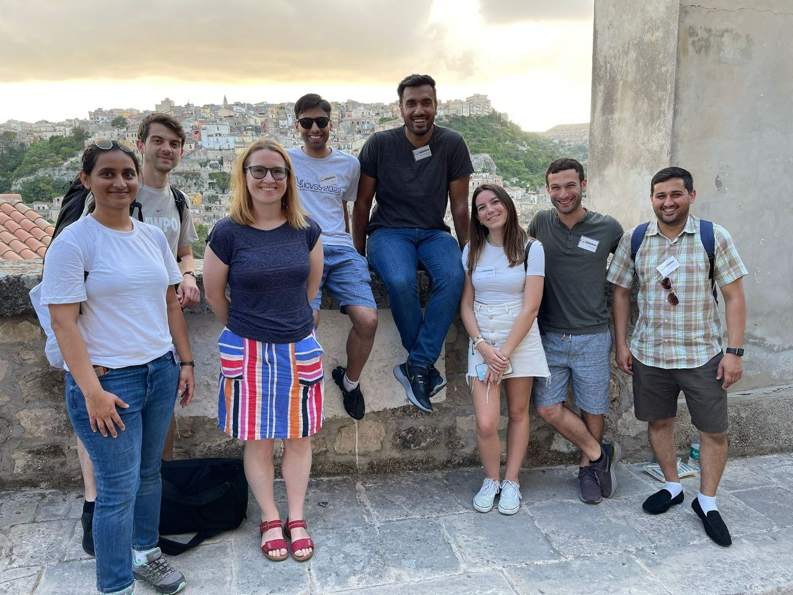

### Activities

- **Local Chair** of the 8th International Workshop on Computer Vision (IWCV 2026), Stresa, Italy. 2026
- **Organizer** of the Third Joint Egocentric Vision (EgoVis) Workshop at CVPR 2026, Denver, CO, USA. 2026
- **Organizer** of the Real-World Video Representation Learning Workshop at ECCV 2026, Malmö, Sweden. 2026
- **Member** of the [European Laboratory for Learning and Intelligent Systems (ELLIS)](https://ellis.eu/). 2026-now
- **Associate Chair** of the conference VISAPP 2026, Marbella, Spain. 2026
- **Doctoral Consortium:** Participation at the Doctoral Consortium at [ICCV 2023](https://iccv2023.thecvf.com/call.for.participation-363200-2-30-32.php), Paris, France. 2023
- **Organizer** of [Women In Computer Vision Workshop (WiCV)@ICCV 2023](https://sites.google.com/view/wicviccv2023/home), Paris, France. 2023
- **Summer School:** Participation at the [International Computer Vision Summer School (ICVSS 2022)](https://iplab.dmi.unict.it/icvss2022/), Catania, Italy. 2022
- **Staff Member** in the organization of [I-RIM 2021 Conference](https://i-rim.it/it/conferenza-i-rim-2021/), Rome. 2021
- **Summer School:** Participation at the [4th International School on Deep Learning](https://deeplearn.irdta.eu/2023su/), Las Palmas de Gran Canaria, Spain. 2021
- **Reviewer:** ICCV, CVPR, ECCV, WACV, ICPR, IROS, NIPS, RA-L, CVIU, IJCV, T-PAMI, IEEE Signal Processing Letters, Applied Intelligence, IEEE Transactions on Multimedia, International Journal of Multimedia Information Retrieval, Pattern Recognition

  

