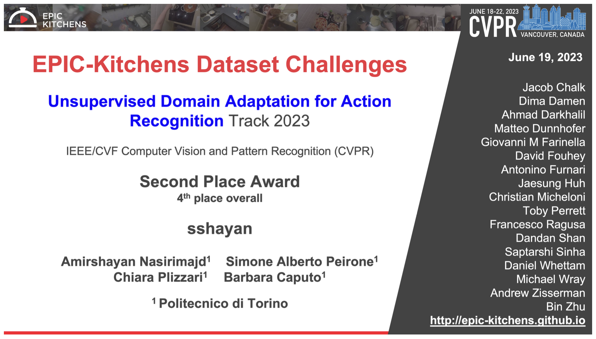
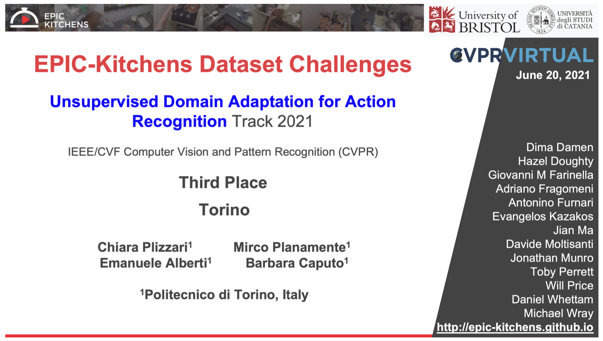

### Awards & Grants

- **Google Research TPU Award**: 50,000 TPU hours, team member / collaborator. Google. 2026
- **Bocconi Junior Researchers' Grant**: *EgoWorld: Understanding the World from an Egocentric Perspective* (PI, EUR 10,000). Bocconi University, Italy. 2025
- **CINECA ISCRA-C Computational Grant**: *EgoWorld: Understanding the World from an Egocentric Perspective* (PI, 1,868,192 standard computational hours). Italy. 2025
- **AIxIA Award for Best PhD Thesis**: "Marco Cadoli" Prize for Newly Awarded PhDs. Italy. 2025
- **HD-EPIC VQA Challenge (1st place)**: CVPR 2025, Nashville. 2025
- **Best PhD Award**: among Ph.D. of the 36th cycle. Politecnico di Torino, Italy. 2024
- **Doctoral Consortium**: selected as a mentee @ ICCV 2023. Paris, France. 2023
- **[EPIC-Kitchens Unsupervised Domain Adaptation challenge for Action Recognition](https://epic-workshop.org/EPIC_CVPR23/submission) (2nd place)**: CVPR, Vancouver. 2023
- **[EPIC-Kitchens Unsupervised Domain Adaptation challenge for Action Recognition](https://epic-workshop.org/EPIC_CVPR21/submission) (3rd place)**: CVPR, Virtual. 2021
- **ACE Datathon 2019 - Analytics Club ETH (2nd place)**: ETH University, Zurich. 2019

  
  

