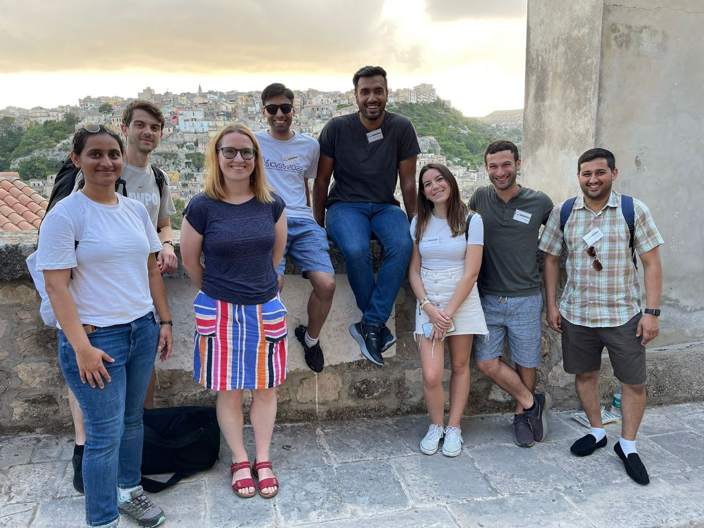

### Academic Service

- **Associate Editor**, *Pattern Recognition* (Elsevier). 2026–present
- **Local Chair**, [8th International Workshop on Computer Vision (IWCV 2026)](https://rzabih.github.io/iwcv2026/), Stresa, Italy. 2026
- **Organizer**, [Third Joint Egocentric Vision (EgoVis) Workshop, CVPR 2026](https://egovis.github.io/cvpr26/), Denver, USA. 2026
- **Organizer**, [Real-World Video Representation Learning Workshop, ECCV 2026](https://sites.google.com/utwente.nl/re-vrl/home), Malmö, Sweden. 2026
- **Associate Chair**, [VISAPP 2026](https://visapp.scitevents.org), Marbella, Spain. 2026
- **Organizer**, [Women in Computer Vision (WiCV) Workshop, ICCV 2023](https://sites.google.com/view/wicviccv2023/home), Paris, France. 2023
- **Organizing Staff**, [I-RIM 2021 Conference](https://i-rim.it/it/conferenza-i-rim-2021/), Rome, Italy. 2021
- **Reviewer**: CVPR, ICCV, ECCV, NeurIPS, WACV, ICPR, IROS; RA-L, CVIU, IJCV, and IEEE TPAMI. 2021–present

#### Professional Memberships
- **Member**, [European Laboratory for Learning and Intelligent Systems (ELLIS)](https://ellis.eu). 2026–present

#### Additional Training
- **Participant**, [International Computer Vision Summer School (ICVSS 2022)](https://iplab.dmi.unict.it/icvss2022/), Catania, Italy. 2022
- **Participant**, 4th International School on Deep Learning, Las Palmas, Spain. 2021

  

