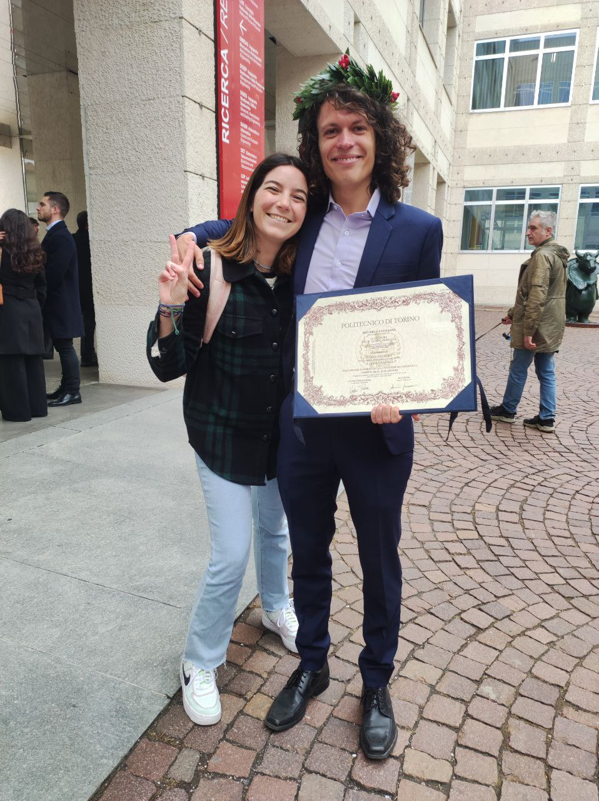
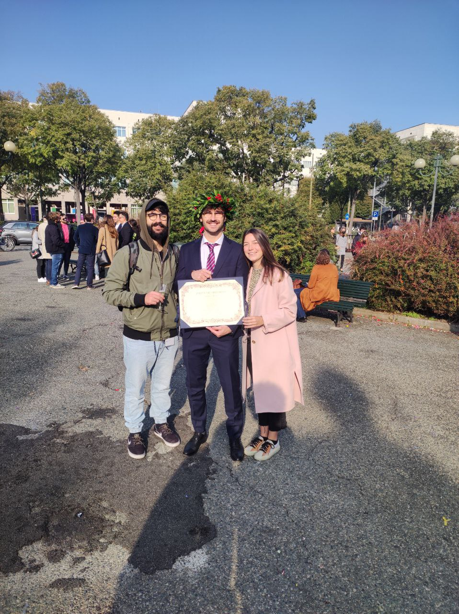

### Teaching

#### Course Director
- **[Deep Learning for Computer Vision (20600)](https://www.unibocconi.it/en/faculty/chiara-plizzari)**, M.Sc., Bocconi University. 2025-2026, 2026-2027
- **[Computer Vision and Image Processing (20878)](https://www.unibocconi.it/en/faculty/chiara-plizzari)**, M.Sc., Bocconi University. 2025-2026, 2026-2027

#### Teaching Assistant
- **Machine Learning and Deep Learning**, M.Sc., Politecnico di Torino. 2021-2022, 2022-2023

#### Supervision @ Bocconi University
As PI of the Vision and Video Understanding group, I am currently:
- Co-supervising 2 Ph.D. students
- Supervising 5 Research Assistants
- Supervising 10 M.Sc. thesis students and co-supervising 5 M.Sc. students

#### Master Thesis Co-Supervisor

  
  

- *LLMs for Training Text-Description Losses*, Olivieri, L., Politecnico di Milano. ongoing
- *LLMs for Video Understanding*, Lo Gatto, S., Politecnico di Milano. ongoing
- *Neurosymbolic Methods for Video Understanding*, Gesualdi, D., Politecnico di Milano. ongoing
- *Egocentric 4D Understanding*, Taluzzi, A., Politecnico di Milano. ongoing
- *Skeleton-based Pose Estimation*, Marchetti, E., Politecnico di Torino. 2024
- *Egocentric 3D Scene Understanding*, Borgna, F., Politecnico di Torino. 2024
- *Large Language Models for Domain Adaptation in Egocentric Action Recognition*, Nasirimajd, A., Politecnico di Torino. 2024
- *Pseudo-label Techniques for Domain Adaptation*, Guerrier, R., University of Bristol. 2022
- *Test-Time Adaptation for Egocentric Action Recognition*, Neubert, J., Peirone, S., Politecnico di Torino. 2021
- *Domain Adaptation for Egocentric Action Recognition*, Zaccone, R., Politecnico di Torino. 2021
- *Egocentric Event-data for cross-domain analysis in first-person action recognition*, Goletto, G., Gusso, E., Politecnico di Torino. 2020
